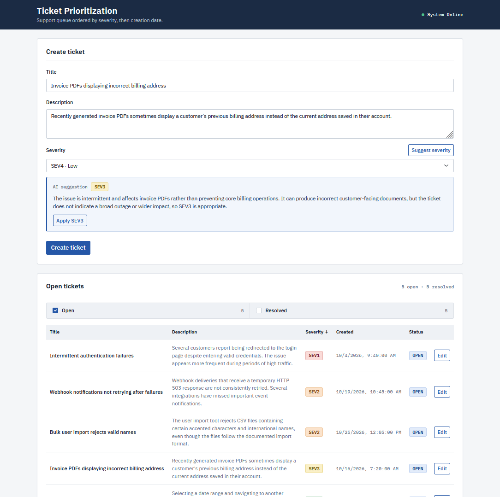

# Ticket Prioritization System

A full stack support ticket application built with Java, Spring Boot, React, and TypeScript. The application provides a REST API and a browser dashboard for creating, updating, prioritizing, and tracking support tickets.

The dashboard supports ticket management and status filtering. Users can also request an AI assisted severity suggestion based on a ticket's title and description, review the recommendation, and choose whether to apply it.

## Application Preview



## Features

### Ticket management

1. Create tickets with a title, description, and severity.
2. View all tickets or retrieve an individual ticket by ID.
3. Edit ticket details and change ticket status.
4. Delete tickets from the dashboard or REST API.
5. Store ticket records in MongoDB.

### Severity and status

Tickets use four severity levels: `SEV1`, `SEV2`, `SEV3`, and `SEV4`. New tickets start with an `OPEN` status. Tickets can be changed to `RESOLVED`.

The backend orders tickets by severity and creation time. The dashboard can sort by severity and filter between open and resolved tickets. Severity and status are displayed with badges in the interface.

### AI severity suggestions

The application includes an endpoint that uses the OpenAI Java SDK to request a severity recommendation from the ticket title and description. The response includes a suggested severity and a short explanation.

The suggestion is user initiated. It does not automatically change a ticket's severity. The user can review the recommendation and choose to apply it in the form.

### Backend status and validation

The dashboard checks the backend health endpoint and displays whether the backend is connecting, online, or unavailable. It retries while the backend is starting.

The API uses request validation for supported input fields and returns errors for invalid requests or tickets that cannot be found.

## Technology

### Backend

1. Java 25
2. Spring Boot 4.1.2 and Spring MVC
3. Spring Data MongoDB
4. Jakarta Bean Validation
5. OpenAI Java SDK
6. Maven
7. JUnit and Spring Boot Test

### Frontend

1. React 19
2. TypeScript
3. Vite
4. Bootstrap 5
5. CSS

### Containerization

The repository includes a Dockerfile that builds and packages the Spring Boot backend into a Java runtime image.

## Application structure

The frontend is located in the `frontend` directory. It contains the React application, ticket components, TypeScript models, and API service functions.

The backend is a Spring Boot application. Its controllers expose the REST endpoints, service classes handle application logic, and the ticket repository uses Spring Data MongoDB to access ticket records.

The main request flow is:

```text
Browser dashboard
       |
       v
React and TypeScript frontend
       |
       v
Spring Boot REST API
       |
       v
Ticket service and MongoDB repository
       |
       v
MongoDB
```

Severity suggestions use a separate backend service that sends the ticket information to the OpenAI API and returns the structured recommendation to the frontend.

## API

### Ticket endpoints

1. `GET /api/tickets` retrieves tickets ordered by severity and creation time.
2. `GET /api/tickets/{id}` retrieves one ticket.
3. `POST /api/tickets` creates a ticket.
4. `PATCH /api/tickets/{id}` updates ticket details and status.
5. `DELETE /api/tickets/{id}` deletes a ticket.

### Supporting endpoints

1. `POST /api/severity-suggestions` requests an AI severity suggestion.
2. `GET /actuator/health` checks backend health.

### Create a ticket

Send a `POST` request to `/api/tickets` with a JSON body. New tickets default to `OPEN` status.

```json
{
  "title": "Login page is broken",
  "description": "Users cannot sign in",
  "severity": "SEV1"
}
```

Example request:

```bash
curl -i -X POST http://localhost:8080/api/tickets \
  -H "Content-Type: application/json" \
  -d '{"title":"Login page is broken","description":"Users cannot sign in","severity":"SEV1"}'
```

Valid severity values are `SEV1`, `SEV2`, `SEV3`, and `SEV4`. Valid status values are `OPEN` and `RESOLVED`.

## Run locally

### Requirements

1. JDK 25
2. Maven
3. Node.js and npm
4. A MongoDB instance
5. An OpenAI API key

### Configure the backend

The backend reads configuration from environment variables and can load values from a `.env` file in the repository root. Create that file with your local settings:

```properties
MONGODB_URI=mongodb://localhost:27017
MONGODB_DATABASE=ticket_system
OPENAI_API_KEY=your-openai-api-key
APP_DEMO_MODE=false
```

`OPENAI_MODEL` can be set to choose a different model. The application currently defaults to `gpt-6-luna` when that setting is not supplied. The server uses port `8080` by default. The `PORT` environment variable can override it.

Do not commit the `.env` file or your API key.

### Start the backend

From the repository root, run the tests and start the Spring Boot application:

```bash
mvn clean test
mvn spring-boot:run
```

The API will be available at `http://localhost:8080` when the application starts successfully.

### Start the frontend

Open a second terminal and run:

```bash
cd frontend
npm install
npm run dev
```

Open the local Vite address shown in the terminal. The default address is `http://localhost:5173`.

During local development, the Vite configuration proxies requests to `/api` and `/actuator` to the backend at `http://localhost:8080`.

### Frontend API configuration

The frontend reads `VITE_API_BASE_URL` to determine the backend API base URL. It defaults to an empty string for local development with the Vite proxy.

When hosting the frontend separately from the backend, set `VITE_API_BASE_URL` to the backend's base URL in the frontend deployment environment. The backend CORS configuration must allow requests from the frontend origin.

## Tests and build

Run the backend test suite from the repository root:

```bash
mvn clean test
```

Build and lint the frontend from the `frontend` directory:

```bash
npm run build
npm run lint
```

## Docker

Build the backend image from the repository root:

```bash
docker build -t ticket-prioritization-system .
```

The container needs the MongoDB connection settings and OpenAI API key supplied through its runtime environment.

## Notes

AI severity suggestions are recommendations for the user to review. They are not a substitute for confirming the real impact of an incident.

The frontend and backend can be run locally as separate applications. For a separate frontend deployment, configure the API base URL and the backend's allowed CORS origins.
